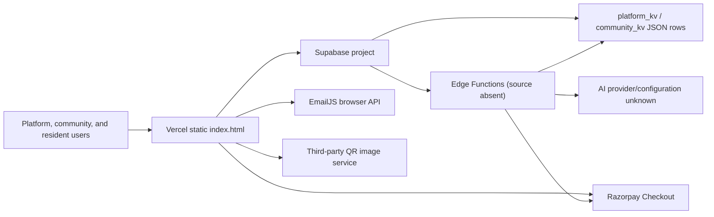
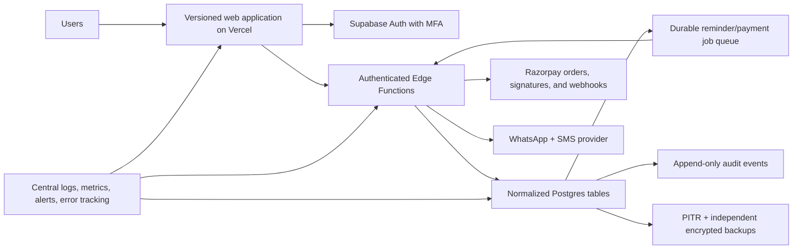

# Architecture

## Current system

OurCommunity is a multi-portal community-management SaaS delivered as a single static `index.html` file from Vercel. It supports platform administrators/staff, community administrators/staff/security, and residents (owners or tenants). Features include resident records, invoicing, dues, payment submissions, expenses, reports, amenities, visitors, vehicles, notices, support, staff, AI-assisted reconciliation, and browser-driven backup/export.

There is no build system, dependency manifest, server source, test suite, schema migration, or infrastructure-as-code in this repository. Browser code loads Bootstrap, Bootstrap Icons, Chart.js, SheetJS, PDF.js, Supabase JS, EmailJS, and Razorpay from CDNs.

The browser references 16 Edge Functions: platform/community bootstrap and authentication/reset/change-password functions, platform administration, community KV writes, an AI assistant, and Razorpay order creation. Their source and deployed configuration are not available for review.

## Data architecture

The browser maintains an in-memory cache. `platform_kv` stores platform objects; `community_kv` stores one JSON value per `(community_id, key)`. Community keys include administrators, owners, invoices, payments, expenses, staff, amenities, visitors, vehicles, notices, support, backups, and activity logs.

This is a document/KV design, not a normalized relational design. Whole arrays are rewritten asynchronously. Consequences include lost updates, weak referential integrity, large write amplification, limited queryability, and an inability to apply row-level policies to individual invoices, payments, or residents.

## Request and trust boundaries

- The URL hash selects a community; it is routing state, never an authorization boundary.
- Custom session tokens are kept in `sessionStorage` and sent in `x-platform-session` or `x-community-session` headers.
- The browser performs UI authorization, but all material authorization must also occur in Edge Functions and database policies.
- Supabase publishable/anonymous keys and EmailJS public keys are client identifiers, not secrets.
- Razorpay and AI credentials must exist only in server-managed secret storage.

## Target architecture

Each domain table should have a non-null `community_id` foreign key. Membership and role tables should drive RLS through authenticated identity, not community slugs or client-supplied IDs. Financial mutations should use database transactions and immutable event records. Scheduled reminders should be server-side, idempotent, consent-aware, and observable.

## Recommended decomposition

1. Establish a reproducible project (framework/build lockfile, local and CI commands, pinned dependencies).
2. Adopt Supabase Auth or formally specify, test, and independently review the custom authentication protocol.
3. Migrate one bounded domain at a time from KV JSON to normalized tables, starting with identity/membership, invoices, payments, and audit events.
4. Put all sensitive mutations behind authenticated server APIs; remove anonymous direct-table fallbacks.
5. Add queues/cron for notifications and webhook-driven payment reconciliation.
6. Add staging, migrations, automated tests, observability, and recovery exercises before production data migration.

The initial MSG91 WhatsApp/SMS reminder worker is documented in [MESSAGING_INTEGRATION.md](MESSAGING_INTEGRATION.md). It is staged locally and is not deployed.
