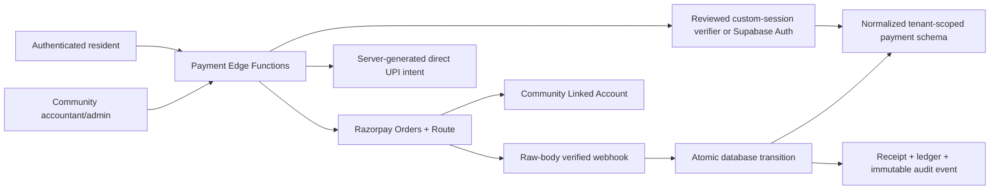

# Payment Architecture Assessment

Assessment date: 2026-08-18

## Decision

The current payment implementation is **not a safe base for production payment activation**. A normalized, server-authoritative subsystem can be introduced alongside it, but live payment processing must remain disabled until the actual Supabase schema, custom-session verifier, deployed Edge Functions, and RLS policies are available and tested.

## Current architecture

- The repository is a single static `index.html` deployed on Vercel, not a React/Next.js application.
- It uses Supabase JS directly and a custom authentication/session protocol, not Supabase Auth as assumed by the implementation brief.
- Platform and community data are JSON documents in `platform_kv` and `community_kv`. Invoices and payments are arrays inside tenant JSON rather than relational rows.
- Sixteen referenced Edge Functions are absent from source control. This includes authentication, protected bootstrap/write functions, and `razorpay-create-order`.
- The actual production database schema, RLS, functions, secrets, and logs are unavailable in the connected tooling.
- Existing browser code submits `amount`, `invoiceId`, `ownerId`, and `communityId` to `razorpay-create-order`. The server implementation cannot be inspected.
- The Razorpay Checkout handler creates a client-side payment submission from callback values. A community admin later approves it. No signature-verification or webhook source is present.
- Community Razorpay key ID and secret are entered through the browser and sent to a platform Edge Function. Storage and encryption cannot be verified.
- Existing manual reconciliation is browser-driven and writes whole JSON arrays. Approval, invoice mutation, payment mutation, and audit logging are not atomic.
- Existing financial records can be physically deleted from the browser. Activity logs are mutable tenant JSON.

## Critical findings to resolve

1. **Authentication mismatch:** production-grade RLS cannot be based on `auth.uid()` until Supabase Auth is actually adopted. With custom sessions, tenant authorization must be performed in a reviewed server gateway, while payment tables deny all client writes.
2. **No authoritative invoice rows:** amount, outstanding balance, ownership, and community cannot be transactionally derived from JSON documents with database foreign keys.
3. **No inspectable payment backend:** signature verification, capture validation, Route mapping, webhook authentication, refunds, and secret storage are unverified.
4. **Client-side financial state:** browser callbacks and admin UI currently mutate payment/invoice JSON. This cannot coexist as an authoritative path after migration.
5. **No tenant-enforceable relationships:** resident, unit, invoice, payment, transfer, refund, receipt, and audit records cannot currently be joined and constrained by `community_id`.
6. **No immutable/idempotent ledger:** duplicate callbacks, webhook retries, concurrent approvals, and delete/recreate operations can cause inconsistent accounting.

## Current Razorpay requirements verified

- Standard Checkout returns `razorpay_payment_id`, `razorpay_order_id`, and `razorpay_signature`; signature verification is mandatory on the server using HMAC-SHA256 over `order_id + "|" + payment_id`.
- An order amount is an integer in currency subunits. Its `receipt` is unique and acts as an idempotency control.
- A payment must be captured before fulfilment. Webhooks are the primary automation mechanism; an API fetch can supplement them for immediate UX.
- Route requires Linked Accounts. Transfers can be created with an INR order; after capture/order payment, the transfer is automatically created and settled to the selected Linked Account.
- Route order transfers cannot use partial payments. A transfer below the order amount leaves the balance in the primary/nodal account, so the implementation must deliberately transfer the approved destination amount and must not silently retain community funds.
- Webhook validation requires the unmodified raw body and `X-Razorpay-Signature`. Duplicate events are identified by `x-razorpay-event-id`, and delivery order is not guaranteed.
- Route has separate transfer/settlement/failure webhooks. Refunds may require transfer reversal; partial and full reversal/refund behavior must follow the linked account's balance and Razorpay configuration.

Official references:

- [Razorpay Standard Checkout](https://razorpay.com/docs/payments/payment-gateway/web-integration/standard/integration-steps/)
- [Orders API](https://razorpay.com/docs/api/orders/create/)
- [Route integration](https://razorpay.com/docs/payments/route/integration-guide/)
- [Transfers from orders](https://razorpay.com/docs/api/payments/route/create-transfers-orders/)
- [Webhook validation and idempotency](https://razorpay.com/docs/webhooks/validate-test/)
- [Route webhooks](https://razorpay.com/docs/webhooks/route/)
- [Refunds and transfer reversal](https://razorpay.com/docs/payments/route/reversal/)

## Target architecture

## Backward-compatible migration strategy

1. Create normalized payment tables without changing legacy KV data.
2. Initially deny `anon` and `authenticated` direct writes. Only reviewed Edge Functions may mutate financial state.
3. Build a one-time importer that maps immutable legacy community/resident/unit/invoice identifiers. Reconcile row counts and control totals before enabling payments.
4. Dual-read for display while the new subsystem is in pilot; do not dual-authoritatively write financial outcomes.
5. Enable one synthetic/test community with `payments_enabled = false` globally and a community pilot flag.
6. Run cross-tenant, amount-tampering, webhook, race, refund, and reconciliation tests.
7. Make normalized tables authoritative only after sign-off; then remove browser-side approval/deletion/status mutation paths.

## Proposed logical schema

- `payment_communities` / mapping to the authoritative community source
- `payment_memberships` or an adapter to the authoritative identity/membership source
- `payment_residents`, `payment_units`, `payment_invoices` (migration bridge if the core product is not normalized first)
- `community_payment_settings` with approval status and versioned destination changes
- `payment_attempts` with amount in paise and a constrained state machine
- `payment_transfers`
- `payment_refunds`
- `payment_webhook_events` with unique provider event ID and payload hash
- `payment_reconciliations`
- `payment_receipts`
- `payment_ledger_entries`
- `payment_audit_events`

Every tenant-owned row must contain a non-null `community_id`; composite foreign keys should include `community_id` so an identifier from Community A cannot reference a row in Community B.

## Implementation gate

Before database or server implementation can be considered deployable, obtain:

- Source for the deployed custom-auth and protected-write Edge Functions.
- The real production-equivalent schema and RLS policies.
- A staging Supabase project/branch with synthetic data.
- Razorpay Test Mode account with Route enabled and at least one test Linked Account.
- A decision to migrate to Supabase Auth or a formal specification of the custom session token verification protocol.

Production RLS, payment migrations, secrets, Razorpay webhooks, Route activation, and data backfills are **REQUIRES MANUAL PRODUCTION APPROVAL**.
